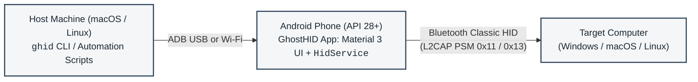

# GhostHID

Android Bluetooth HID controller, Material 3 app and automation gateway.

GhostHID turns an Android phone into a physical Bluetooth Human Interface Device (HID) composite peripheral. It injects keyboard keystrokes, pointer gestures, text strings, and automated login sequences into any paired Windows, macOS, or Linux computer.

The phone runs a background Android service plus a Material 3 Expressive dashboard, controlled locally or over Wi-Fi via ADB and the `ghid` command-line utility.



## Why GhostHID?

macOS does not support the Bluetooth HID Peripheral role. A Mac can connect to external keyboards and mice as a host, but it cannot advertise itself as a Bluetooth input device to control another computer.

Android 9+ (API 28+) supports the native Bluetooth HID Device profile (`BluetoothHidDevice`). GhostHID uses an Android device as an ADB-driven transport bridge. You control the Android phone from your Mac over USB or Wi-Fi using ADB, and the phone connects to your target machine (such as a Windows laptop) as a standard Bluetooth keyboard and mouse. The target system requires no custom software, drivers, or agent daemons. It sees only a standard wireless HID peripheral.

### Agent and automation design

GhostHID is built for headless operation and AI agents:
- Every command supports `--json` with structured schemas and machine-readable output.
- Scripting invocations disable interactive prompts, confirmations, and terminal alternate screens.
- Deterministic exit codes allow scripts and agents to distinguish connection errors from syntax or device errors.
- Low-latency keystroke injection, combo sequences, and raw HID reports allow autonomous agents to operate target computers without accessibility APIs or screen-scraping hooks.

## Documentation Index

- [System Architecture Specification](docs/architecture.md): Subsystem topology, Android foreground service lifecycle, dual-report HID descriptor bytecode, and security model.
- [Execution and Lifecycle Flows](docs/flows.md): Sequence diagrams for automated login, combo execution, Bluetooth SDP handshakes, ACPI sleep teardown, and diagnostic health checks.
- [Wire and Report Protocol Specification](docs/protocol-spec.md): Binary report payloads, L2CAP channels, USB HID scancode translation table, and ADB intent extras.
- [Troubleshooting and Operational Runbook](docs/troubleshooting.md): Step-by-step diagnosis for ADB transport drops, Windows audio-vs-HID driver binding, Bluetooth state desync, and macOS Keychain in SSH.
- [Automation and Agent Integration Guide](docs/agent-integration.md): Machine-readable `--json` schemas, exit code definitions, and integration recipes for Bash, Python, and Node.js.
- [Standalone Android Toolchain (Gradle Release Pipeline)](docs/build-and-toolchain.md): How `build.sh` and `ghid build` drive `:app:assembleRelease`, R8 shrinking, and publishing of `build/ghost-hid.apk`.
- [Architecture Decision Records](docs/decisions/):
  - [ADR-001: Headless Android Service with BroadcastReceiver IPC over ADB](docs/decisions/ADR-001-headless-android-service-adb-ipc.md)
  - [ADR-002: Dual-Report HID Descriptor for Keyboard and Mouse](docs/decisions/ADR-002-dual-report-descriptor-for-keyboard-and-mouse.md)
  - [ADR-003: Charm TUI with Structured JSON API and Native Credential Vault](docs/decisions/ADR-003-charm-tui-with-json-agent-api-and-keychain-vault.md)
  - [ADR-004: Snippets Subsystem, Dynamic Combo Variables, and Unified Quick Send](docs/decisions/ADR-004-snippets-subsystem-and-quick-send.md)
  - [ADR-005: Combo Metadata and Unified Stepper Engine](docs/decisions/ADR-005-combo-metadata-and-unified-stepper.md)
  - [ADR-006: Standalone Android Material 3 Expressive UI with Bi-directional Shared State](docs/decisions/ADR-006-material3-expressive-android-ui-and-shared-state.md)
  - [ADR-007: Passive Target Host OS Fingerprinting](docs/decisions/ADR-007-host-os-fingerprinting.md)
  - [ADR-008: Composite HID Report Descriptor and Auto-Inferred Raw Dispatch](docs/decisions/ADR-008-composite-descriptor-and-auto-inferred-raw-dispatch.md)
  - [ADR-009: Bi-directional Synchronization and Android as Single Source of Truth](docs/decisions/ADR-009-bidirectional-sync-and-android-ssot.md)
  - [ADR-010: macOS & Cross-Platform Gestures Adaptation, Vector Iconography, and Inset-Aware Shade Docking](docs/decisions/ADR-010-macos-and-cross-platform-gesture-adaptation.md)
  - [ADR-011: Quick Send Unified Iconography and Device-Driven Host Coupling](docs/decisions/ADR-011-quick-send-unified-iconography-and-host-coupling.md)
  - [ADR-012: Single Non-Headless Android App and Release-Only Deployment](docs/decisions/ADR-012-single-android-app-and-release-only-deployment.md)
  - [ADR-013: Combo Emoji Icon Override](docs/decisions/ADR-013-combo-emoji-icon-override.md)
  - [ADR-014: Raw Snippets, Strict Security Boundary, and Material 3 Expressive Controls](docs/decisions/ADR-014-raw-snippets-security-boundary-and-m3-expressive-controls.md)
  - [ADR-015: Unified Bracket Sequence DSL and Payload Subsystem](docs/decisions/ADR-015-unified-bracket-sequence-dsl-and-payloads.md)
- [Prompt: Build Your Own Headless Android App](docs/prompts/headless-android-app.md): the complete ADB broadcast, status and file contract for coding a UI-less gateway app from scratch.

## Quick Start

### 1. Install the CLI
Link `ghid` into your path (`~/.local/bin`) and register the UNIX manual page:

```bash
./ghid install-bin
```

Verify the installation:
```bash
which ghid
# /Users/sj/.local/bin/ghid

man ghid
```

To remove the symlink and man page later:
```bash
ghid uninstall-bin
```

### 2. Connect Your Phone via ADB
Enable Developer Options and USB Debugging on your Android phone. Connect via USB or Wi-Fi:

```bash
# Connect over Wi-Fi (if wireless debugging is enabled on phone)
adb connect 192.168.1.80:41839
```

### 3. Build and Install the Phone APK
The build script drives the Gradle wrapper in `android/` and always produces a **release** APK:

```bash
./build.sh
ghid install-apk
```

`ghid build` runs the same script, and `ghid install-apk` installs `build/ghost-hid.apk` (package `com.sj010.ghid`) via `adb install -r`.

### 4. Pair Phone to Target Computer
Pair the phone and target computer over Bluetooth before first use. See [Bluetooth Pairing Setup](#bluetooth-pairing-setup) for the required Windows settings.

> [!NOTE]
> **Wake-on-Bluetooth limitation**
> During ACPI sleep states (Modern Standby, S3, or S4 hibernating), internal Bluetooth controllers on most PC laptops are powered down and cannot receive incoming Bluetooth packets.
>
> Tap any physical key or press the power button on the target laptop to power on its Bluetooth controller before connecting via `ghid`.

## Interactive Console

Running `ghid` without arguments opens the full-screen terminal console:

```bash
ghid
```

### Startup Diagnostics
On startup, `ghid` runs through environment checks:
1. Checks for connected USB or wireless ADB devices. If disconnected, an interactive menu allows entering custom IP addresses, ports, or pairing codes.
2. Checks whether package `com.sj010.ghid` is installed. Offers to install the built APK or compile from source.
3. Checks whether phone Bluetooth is enabled.
4. Starts the Android foreground service and waits for SDP profile registration.
5. Connects Bluetooth to the active target computer.

### Main Menu Interface
```text
┌────────────────────────────────────────────────────────┐
  Phone Device:    KB2001 (192.168.1.80:41839)
  Gateway HID:     READY
  Target Laptop:   LP-TZD-0X114650 [38:FC:98:E8:E3:87] -> ● CONNECTED
  Cached Login:    Administrator
└────────────────────────────────────────────────────────┘
Actions:
  [1] login      - Automated Windows unlock & login
  [2] lock       - Lock Windows screen (Win + L)
  [3] sleep      - Hardware ACPI sleep sequence
  [4] type       - Inject text string via keyboard
  [5] combo      - Combo Studio (create / send / delete Windows combos)
  [6] raw        - Inject raw 16-hex byte HID report
  [7] creds      - View / update cached login credentials
  [d] devices    - Registered target devices & pair new laptop/Mac
  [8] reconnect  - Re-trigger Bluetooth connection
  [9] doctor     - Run full hardware & gateway diagnostic check
  [0] exit       - Disconnect Bluetooth & terminate phone service
```

- `login`: Wakes screen (`Ctrl+Alt+Del` then `Esc`), types username and password from the Keychain vault, and presses `Enter`.
- `lock`: Dispatches `Win + L` immediately.
- `sleep`: Dispatches native hardware ACPI sleep sequence (`{WIN_SLEEP}`), putting host to sleep at kernel level.
- `type`: Sends raw text strings as a sequence of keystrokes.
- `combo`: Opens the interactive Combo Studio.
- `raw`: Sends explicit 8-byte raw hex reports directly to the HID driver.
- `devices`: Manages target device list and active selection.
- `creds`: Displays or updates credentials stored in the macOS Keychain.
- `doctor`: Runs full diagnostic checks on ADB, APK, Bluetooth, and Keychain.
- `exit`: Disconnects Bluetooth and terminates phone service to conserve battery.

## Command-Line Usage and Automation API

All commands support `--json` for scripts, CI jobs, and AI agents. In JSON mode, interactive prompts are disabled, actions proceed without confirmation, and errors return exit code 1 with JSON error bodies.

### System Diagnostics (`doctor`)
Checks ADB, Android package status, Bluetooth state, SDP registration, target connection, and Keychain storage:

```bash
ghid doctor --json
```

Example output:
```json
{
  "adb_available": true,
  "adb_path": "/opt/homebrew/bin/adb",
  "apk_installed": true,
  "bluetooth_on": true,
  "cached_user": "Administrator",
  "device_connected": true,
  "device_model": "KB2001",
  "device_name": "SJ's OnePlus 8T",
  "device_serial": "192.168.1.80:41839",
  "gateway_connected": true,
  "gateway_registered": true,
  "has_cached_password": true,
  "keychain_available": true,
  "registered_devices": 1,
  "selected_device": {
    "id": "dev-1",
    "name": "LP-TZD-0X114650",
    "address": "38:FC:98:E8:E3:87",
    "platform": "windows",
    "selected": true
  },
  "payloads_count": 3,
  "target_address": "38:FC:98:E8:E3:87",
  "target_laptop": "LP-TZD-0X114650",
  "version": "0.1.0"
}
```

### Connection Status (`status`)
Inspects active connection state:

```bash
ghid status --json
```

The JSON separates `gateway` (ADB reachability and serial) from `hid_link`
(Bluetooth registration and target). `os` falls back to the selected target
device when the phone has no fingerprint (`os_source`), `can_send` is the single
boolean to gate on, and `secure_payloads` is always `device_only`.

Returns exit code 0 if the HID link is connected, 1 if disconnected.

### Automated Login (`login`)
Unlock using stored Keychain credentials:
```bash
ghid login
```

Specify credentials and save them to Keychain for subsequent runs:
```bash
ghid login -u "Administrator" -p "SecretPassword123" --save
```

### Screen Lock and Sleep (`lock`, `sleep`)
```bash
# Immediate screen lock (Win + L)
ghid lock

# Sleep sequence with 5-second countdown and zero-battery exit
ghid sleep --countdown 5
```

### Bi-directional Sync (`sync`) & Android Single Source of Truth (SSOT)
Android flash storage (`/sdcard/Android/data/com.sj010.ghid/files/`) is the authoritative Single Source of Truth (SSOT) for all combos and payloads.
The CLI automatically pulls changes from the phone on startup (<15ms check), and any CLI modifications (`combo save/delete`, `payload set/delete`) push directly to the phone, restart the app to reload in-memory state, and restore Bluetooth connectivity:

```bash
# Full bi-directional sync (pull from phone, merge additions, push back, restart & reconnect)
ghid sync
# Secure payloads never cross the link; the report counts them as payloads_skipped_secure

# Pull only (phone wins name conflicts; local-only entries are kept for the next push)
ghid sync --pull

# Push only (pushes local cache to phone, scrubs secrets, restarts app, reconnects)
ghid sync --push

# Machine-readable automation output
ghid sync --json
```

### Quick Send: Keystroke Typing, Raw Reports & Media Control (`quick`)
Unified entry point for ad-hoc text typing, composite action sequences, and raw HID reports.
Target HID collection (Report ID) is automatically inferred from the payload length:

```bash
# Type text through the virtual keyboard (default)
ghid quick "git status"
ghid quick "Administrator" --json

# quick types text; use combo for sequences and media keys
ghid combo "{playpause}" --json                      # Consumer Play/Pause toggle
ghid combo "{PLAY_PAUSE}" --json                     # PLAY_PAUSE payload (raw cd00)
ghid combo "{WIN_SLEEP}" --json                      # System Control Sleep

# Transmit length-inferred raw HID reports directly
ghid quick --raw "02"               # 1 byte  -> Report ID 3 (System Control: Sleep)
ghid quick --raw "cd00"             # 2 bytes -> Report ID 4 (Consumer: Play/Pause)
ghid quick --raw "01000000"         # 4 bytes -> Report ID 2 (Mouse: Left Click)
ghid quick --raw "08000f0000000000" # 8 bytes -> Report ID 1 (Keyboard: Win/Cmd + L)
```

### Combo Macros and Mouse Gestures (`combo`)
```bash
# One-shot keyboard combos
ghid combo "win+r"
ghid combo "ctrl+shift+esc"

# One-shot mouse gestures (uses HID Report ID 2)
ghid combo mouse click-left
ghid combo mouse click-right
ghid combo mouse click-middle
ghid combo mouse double-click
ghid combo mouse scroll-up
ghid combo mouse scroll-down
```

### Combo Management and Scripting API
Combos can be validated, saved, listed, and sent via CLI or JSON without loading the TUI:

```bash
# Inspect accepted grammar tokens
ghid combo schema --json

# Dump the complete token table (keys, modifiers, consumer, aliases, F-keys)
ghid combo keys --json

# Validate a chained sequence before saving (resolves payload references too)
ghid combo validate "{mod+s}{700ms}rustdesk{400ms}{Enter}" --json
ghid combo validate "{cmd+s}" --os macos --json

# Read a saved combo back
ghid combo show "Open RustDesk" --json

# Prove a combo resolves without sending anything
ghid combo send "Open RustDesk" --dry-run --json

# Save a named combo for a host OS (updates if already exists)
ghid combo save "Open RustDesk" "{mod+s}{700ms}rustdesk{400ms}{Enter}" --os windows --emoji "🚀" --json
ghid combo save "Spotlight" "cmd+space" --os macos --emoji "🔎" --json
ghid combo save "PlayPause" "{PLAY_PAUSE}" --os macos --json

# --emoji is optional metadata: it overrides the OS logo on the Android combo card
# and replaces the [win] / [mac] / [linux] badge in 'ghid combo list'

# List saved combos, optionally scoped to one OS
ghid combo list --json
ghid combo list --os macos --json

# Built-in macOS shortcuts
ghid combo send "MacSleep" --json      # {mod+ctrl+q}{500ms}{Escape} (Locks screen & sleeps display)
ghid combo send "ForceQuit" --json     # {mod+alt+esc}{400ms}{Enter}{300ms}{Enter} (Force quits frontmost app)
ghid combo send "PlayPause" --json     # {PLAY_PAUSE} payload -> raw cd00

# Send any saved combo by name
ghid combo send "Open RustDesk" --json

# Delete a saved combo
ghid combo delete "Open RustDesk" --json
```

`combo save` refuses missing payload references. Add `--allow-unresolved` for a
secure payload that only exists on the phone. The output only says `synced to
Android` when an attached phone was actually pushed.

Saved combos are stored in `~/.config/ghid/combos.json`.

### Target Device Management (`devices`)
Manage multiple target computers (for example, switching between a work laptop and a home Mac):

```bash
# Scan/list bonded Bluetooth devices directly from the phone (zero manual MAC typing)
ghid devices scan
ghid devices scan --json

# List all registered devices in local config
ghid devices list
ghid devices list --json

# Add a target device and set it as active
ghid devices add --name "MacBook Pro M3" --addr "F8:FF:C2:11:22:33" --os macos --select

# Switch connection to a different device by ID, address, or name
ghid devices select "dev-1"
ghid devices select "F8:FF:C2:11:22:33"
ghid devices select "MacBook Pro M3"

# Unregister a target device
ghid devices delete "F8:FF:C2:11:22:33" -f
```

In the interactive TUI (`ghid`), pressing `[d]` -> `[a]` lets you select your OS (Mac/Windows), displays a step-by-step pairing checklist with phone Bluetooth name detection, and enters an interactive device picker loaded live from the phone. Selecting a device auto-registers and connects immediately without manual MAC address entry.

Device profiles are stored in `~/.config/ghid/config.json`.

### Credential Vault (`creds`)
Inspect or clear passwords stored in macOS Keychain (`ghost-hid` service):

```bash
# View cached user status
ghid creds status --json

# Save user and password manually
ghid creds set -u "Administrator" -p "SecretPassword123"

# Clear cached credentials
ghid creds clear
```

### Log Viewing (`logs`, `tail`, `filelog`)
```bash
# View last 50 logcat messages from phone gateway
ghid logs -n 50

# Live stream logcat output
ghid tail

# Print full persistent log file from phone storage
ghid filelog
```

## Unified Bracket Sequence DSL

GhostHID uses a single, unified `{...}` bracket sequence grammar across Go, Android/Kotlin, the CLI, and TUI.

```text
samxn81@gmail.com{Tab}{PASSWORD}{Enter}{500ms}{mod+s}{100ms}{WIN_SLEEP}
```

### Syntax Rules
1. **Plain Text**: Everything outside `{}` is typed literally as keystrokes.
2. **Escaped Bracket**: `{{` evaluates to a literal `{` within typed text.
3. **Execution Delay**: Numbers followed by `ms` or `s` (e.g. `{500ms}`, `{1s}`, `{100ms}`) trigger execution delays.
4. **Keyboard Chords**: Tokens containing `+` trigger simultaneous modifier + key chords (e.g. `{mod+s}`, `{ctrl+alt+del}`). The `mod` modifier dynamically resolves to **Command (GUI)** on macOS and **Ctrl** on Windows/Linux.
5. **Standard & Consumer Keys**: `{Tab}`, `{Enter}`, `{Escape}`, `{Space}`, `{Del}`, `{Up}`, `{F1}`-`{F24}`, or consumer media keys `{VolumeUp}`, `{VolumeDown}`, `{Mute}`, `{playpause}`. A bare modifier such as `{shift}` is a valid modifier-only step. Consumer keys cannot carry modifiers.
   - `playpause` is the media key. `play_pause` is the **payload** name (`PLAY_PAUSE`, default raw report `cd00`), so `{PLAY_PAUSE}` resolves through the payload vault.
6. **Mouse Gestures**: `{click-left}`, `{click-right}`, `{click-middle}`, `{double-click}`, `{scroll-up}`, `{scroll-down}`.
7. **Named Payloads**: Any braced identifier that is not a key, modifier, mouse gesture, delay or raw report (e.g. `{PASSWORD}`, `{EMAIL}`, `{WIN_SLEEP}`) resolves against the payload vault. Names are case-insensitive; uppercase is convention only.

### Payloads Subsystem (`ghid payload`)
Payloads store reusable text strings, secure credentials, and raw HID reports:

```bash
# List all saved payloads
ghid payload list --json

# Set a plaintext or raw payload
ghid payload set username "samxn81@gmail.com"
ghid payload set WIN_SLEEP "02" --raw

# Store a sensitive credential in the hardware Keychain / Android Keystore enclave
ghid payload set password "Secret123!" --secure

# Read or delete a payload
ghid payload get username
ghid payload delete username
```

Flags work in any position: `ghid payload set MAC_POWER 3000 --type raw` stores
`3000` with type `raw` (it does not fold `--type raw` into the value). Payload JSON
reads use one shape — `name`, `type`, `secure`, `source`, `present`, `has_value`,
and `value` only for non-secure entries — so an absent Keychain item is visible as
`present: false` instead of an empty string. Secure items live under service
`ghost-hid` and account `ghid_payload_<lowercase-name>`.

When combos with bundled payloads are saved or synchronized, referenced raw reports (e.g. `{WIN_SLEEP}`, `{PLAY_PAUSE}`) are automatically provisioned in the recipient's local payload store. Secure payloads never sync: they stay device-only, and `sync` reports them as `payloads_skipped_secure`.

## Bluetooth Pairing Setup

To ensure Windows binds the phone as a Bluetooth HID keyboard rather than an audio device:

1. **Clear Existing Pairings:**
   - On Windows: Go to **Settings > Bluetooth & devices**. Under **Devices**, find the phone and select **Remove device**.
   - On Phone: Run `ghid unpair`.
2. **Start Phone HID Service:**
   - Run `ghid start` and ensure `ghid status --json` returns `"registered": true`.
3. **Set Discovery Mode on Windows:**
   - In Windows **Settings > Bluetooth & devices**, scroll down to **Bluetooth devices discovery** and select **Advanced**.
4. **Initiate Pairing from Windows:**
   - Click **Add device > Bluetooth**.
   - Select the phone when it appears in the device list.
   - Confirm the numeric passkey on both Windows and the phone.
   - Once paired, Windows binds the Bluetooth HID Keyboard and Mouse drivers.

## Building from Source

### Android APK

Prerequisites:
- OpenJDK 17
- Android SDK with platform `android-35` and `android/local.properties` pointing at it
- Network access on the first build (Gradle resolves AGP/Kotlin/AndroidX)

Build the **release** APK:
```bash
./build.sh        # android/gradlew :app:assembleRelease -> build/ghost-hid.apk
# or
ghid build
```

Install to connected phone:
```bash
ghid install-apk
```

See [Android Build Toolchain](docs/build-and-toolchain.md) for the full pipeline.

### CLI Binary (`ghid`)

Prerequisites:
- Go 1.21+

Build the binary:
```bash
go build -o ghid ./cmd/ghid
```
