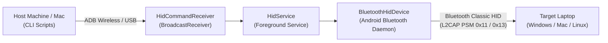

# GhostHID 👻⌨️

> Headless Android Bluetooth HID Keyboard Emulator & Keystroke Injection Engine.

GhostHID turns an Android smartphone into a hardware-recognized Bluetooth Human Interface Device (HID) keyboard capable of injecting keystrokes, shortcuts, and automated authentication sequences into any paired Windows, macOS, or Linux host.

It runs as a persistent background Android Foreground Service controlled entirely via ADB shell commands or host-side scripts—no interactive phone UI tapping required.

---

## The Problem GhostHID Solves

Most third-party "Bluetooth Keyboard & Mouse" apps fail when attempting to connect to enterprise-managed or locked-down Windows laptops:
1. **Device Classification Flaw:** Android smartphones advertise a fixed Bluetooth Class of Device (CoD) identifying them as `Phone`. Windows frequently caches the phone under **"Other devices"** rather than **"Input (Mouse, keyboard & pen)"**, refusing to bind `mshidkmdf.sys` / `hidbth.sys` drivers.
2. **SDP Timing:** If pairing occurs before the Android Bluetooth HID service (`BluetoothHidDevice`) registers its SDP records, Windows treats the connection purely as an Audio/Handsfree profile (A2DP/HFP) and rejects incoming HID L2CAP channels.
3. **Background Lifecycle Killing:** Standard apps terminate their HID proxies when the screen locks or when the activity is minimized.

GhostHID solves this by:
* Broadcasting compliant 8-byte HID keyboard report descriptors directly to the Bluetooth daemon.
* Running inside an unkillable Android 14 `connectedDevice` Foreground Service.
* Exposing a zero-latency IPC broadcast interface to trigger key sequences (`Win + L`, `Ctrl + Alt + Del`, ASCII typing, shortcuts) headlessly from an ADB connection.

---

## Architecture



* **`HidService.java`**: Android Service maintaining the `BluetoothProfile.HID_DEVICE` proxy and managing report generation and pacing.
* **`HidCommandReceiver.java`**: Manifest-registered broadcast receiver responding to `com.poc.hiddebug.ACTION_LOCK` and `ACTION_CMD`.
* **`cli.sh`**: Lightweight host script providing single-line commands to control keystrokes, type text, or inspect connection state.
* **`build.sh`**: Standalone build toolchain using Android CLI tools (`aapt2`, `javac`, `d8`, `zipalign`, `apksigner`) with zero Gradle overhead.

---

## One-Time Bluetooth Pairing Setup

> [!IMPORTANT]
> To ensure Windows installs the **Bluetooth HID Keyboard** driver rather than treating your phone as a multimedia phone:

1. **Remove Old Pairings:**
   * On Windows: Open **Settings $\rightarrow$ Bluetooth & devices**. Under **Other devices**, locate your phone and click **Remove**.
   * On Phone: Run `./cli.sh unpair` (or tap Unpair in the UI).
2. **Ensure HID Service is Active:**
   * Make sure GhostHID is running with SDP registered (`./cli.sh status` should report `"registered": true`).
3. **Enable Advanced Discovery on Windows:**
   * In Windows **Settings $\rightarrow$ Bluetooth & devices**, scroll to **Bluetooth devices discovery** and set it to **Advanced**.
4. **Pair from Windows:**
   * Click **Add device $\rightarrow$ Bluetooth**.
   * Select your phone when it appears.
   * Confirm the pairing passkey on both screens.
   * Once connected, Windows will display the device as **Connected** with an input driver bound.

---

## CLI Usage

All operations can be executed from your terminal via the provided [`cli.sh`](cli.sh) script:

### Check Status
Check whether the phone is actively connected to the target laptop:
```bash
./cli.sh status
```
Output:
```json
{
  "registered": true,
  "connected": true,
  "state": "CONNECTED",
  "target": "LP-TZD-0X114650",
  "address": "38:FC:98:E8:E3:87"
}
```

### Instant Lock (Win + L)
```bash
./cli.sh lock
```

### Type Text
Inject ASCII strings at human-like keypress intervals:
```bash
./cli.sh type "Hello World!"
```

### Key Combinations
Send arbitrary modifiers and keycodes (`win`, `ctrl`, `alt`, `shift`, `del`, `esc`, `tab`, `enter`, `space`):
```bash
# Dismiss lock screen
./cli.sh combo "ctrl+alt+del"
./cli.sh combo "esc"

# Show desktop
./cli.sh combo "win+d"

# Task manager
./cli.sh combo "ctrl+shift+esc"
```

### Connect / Disconnect
```bash
./cli.sh connect
./cli.sh disconnect
```

---

## Automated Login Script

[`login.sh`](login.sh) provides an automated sequence to wake a Windows machine from lock, enter credentials, and log in:

```bash
./login.sh "<username>" "<password>"
```
Or run interactively (with secure hidden password entry):
```bash
./login.sh
```

---

## Building & Installing

Requirements:
* Android SDK build-tools (`aapt2`, `d8`, `zipalign`, `apksigner`)
* OpenJDK 17
* An ADB-connected Android device running Android 9+ (API 28+)

Compile and package the APK:
```bash
./build.sh
```

Install and launch service:
```bash
adb install -r build/ghost-hid.apk
adb shell am start-foreground-service -n com.poc.hiddebug/.HidService
```
