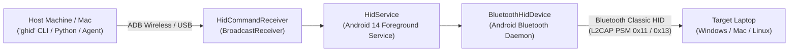

# GhostHID 👻⌨️

> Headless Android Bluetooth HID Keyboard Controller & Automation Gateway.

GhostHID converts an Android smartphone into a hardware-recognized Bluetooth Human Interface Device (HID) keyboard capable of injecting keystrokes, shortcuts, and automated authentication sequences into any paired Windows, macOS, or Linux host.

It runs as a background Android Foreground Service controlled locally or remotely via ADB shell commands and the unified **`ghid`** CLI tool.

---

## What's New in Alpha (`ghid` CLI)

The project now includes **`ghid`**, a native Go-powered CLI built with Charm (Bubble Tea & Lip Gloss) and interactive control console:
- **Interactive TUI Session:** Run `ghid` to automatically start the phone service, verify SDP profile registration, connect Bluetooth to your laptop, and manage login, screen lock, sleep countdowns, typing, and shortcuts.
- **Secure macOS Keychain Integration:** Windows credentials can be cached in the macOS Keychain (`ghost-hid` service) so you never re-type long passwords.
- **Automated Exception Handling & Recovery:** Detects missing ADB, disconnected devices, unauthorized debugging, disabled Bluetooth, or missing APKs, with built-in interactive prompts to pair/connect over Wi-Fi or compile/install the APK.
- **First-Class AI Agent & Scripting Support:** Every command supports `--json` flags, structured exit codes, and non-interactive arguments (`ghid status --json`, `ghid doctor --json`, `ghid login -u ... -p ...`).
- **Full UNIX Man Page & System Symlink:** Run `ghid install-bin` to link `~/.local/bin/ghid` and install `man ghid`.

---

## Quick Installation

GhostHID's CLI is ready to be linked into your `$PATH` (e.g. `~/.local/bin`, which is already loaded in `~/.zshrc`):

```bash
# From within the repository
./ghid install-bin
```

Verify the installation:
```bash
which ghid
# /Users/sj/.local/bin/ghid

man ghid
# or: ghid man
```

To remove the symlink and man page:
```bash
ghid uninstall-bin
```

---

## Hardware & Power State Note (Wake-on-Bluetooth)

> [!NOTE]
> **Wake-on-Bluetooth behavior during ACPI Sleep:**
> When the target Windows laptop is in ACPI sleep (Modern Standby / S3), the host's internal Bluetooth controller is completely unpowered and cannot process incoming Bluetooth packets.
>
> **Standard Workflow:**
> 1. Manually wake the laptop (tap the laptop power button or physical key).
> 2. Run `ghid`.
> 3. The phone's Bluetooth HID gateway establishes the connection within 1–2 seconds.
> 4. Select **`[1] login`** to unlock Windows instantly.

---

## Interactive Mode

Simply run `ghid` from any terminal:

```bash
ghid
```

### Startup & Exception Handling Loop
1. **Device Check:** Scans USB and Wireless ADB (`192.168.1.80:41839`). If no device is detected or if debugging is unauthorized, an interactive recovery menu lets you reconnect, specify a custom IP:PORT, or enter a 6-digit wireless pairing code.
2. **APK Check:** Checks if `com.poc.hiddebug` is installed. If missing, it offers to install the pre-built APK or build it directly from source via `build.sh`.
3. **Bluetooth Radio Check:** If phone Bluetooth is disabled, prompts to turn it on automatically via Android settings.
4. **Gateway & SDP:** Starts the Android foreground service and waits for SDP registration.
5. **Auto-Connect:** Initiates Bluetooth connection with your paired laptop.

### Interactive Menu
```text
┌────────────────────────────────────────────────────────┐
  Phone Device:    KB2001 (192.168.1.80:41839)
  Gateway HID:     READY
  Target Laptop:   LP-TZD-0X114650 [38:FC:98:E8:E3:87] -> ● CONNECTED
  Cached Login:    Administrator
└────────────────────────────────────────────────────────┘
Actions:
  [1] login      - Automated Windows unlock & login
  [2] lock       - Lock Windows screen (Win + L)
  [3] sleep      - Windows Sleep sequence + countdown exit
  [4] type       - Inject text string via keyboard
  [5] combo      - Send custom key combination (win+d, alt+tab)
  [6] raw        - Inject raw 16-hex byte HID report
  [7] creds      - View / update cached login credentials
  [d] devices    - Registered target devices & pair new laptop/Mac
  [8] reconnect  - Re-trigger Bluetooth connection
  [9] doctor     - Run full hardware & gateway diagnostic check
  [0] exit       - Disconnect Bluetooth & terminate phone service
```

* **`login`**: Prompts for credentials if none are cached, securely stores them in macOS Keychain upon request, wakes the lock screen (`Ctrl+Alt+Del` $\rightarrow$ `Esc`), and injects Username $\rightarrow$ `Tab` $\rightarrow$ Password $\rightarrow$ `Enter`.
* **`lock`**: Immediately fires `Win + L`.
* **`sleep`**: Sends Windows sleep sequence (`Win+X` $\rightarrow$ `u` $\rightarrow$ `s`), displays a 5-second countdown, cleanly disconnects Bluetooth, and terminates the Android foreground service so zero battery is drained.
* **`exit`**: Disconnects and terminates the background service cleanly.

---

## Non-Interactive & AI Agent Usage

All commands support direct execution with `--json` for scripts and AI agents:

### 0. Device Management & Registration (`devices`)
Inspect registered targets, add new Windows/macOS devices, switch active targets, or unregister:
```bash
# List all registered devices
ghid devices list
ghid devices list --json

# Register a new device (and optionally set as active target)
ghid devices add --name "MacBook Pro M3" --addr "F8:FF:C2:11:22:33" --os macos --select

# Switch active connection to a different target
ghid devices select "dev-1"
# or by address / name:
ghid devices select "38:FC:98:E8:E3:87"

# Unregister (delete) a device with confirmation (or -f to force)
ghid devices delete "F8:FF:C2:11:22:33" -f
```

### 1. Diagnostic Health Check (`doctor`)
Runs a comprehensive inspection of ADB, device link, APK status, Bluetooth radio, SDP registration, laptop link, and Keychain vault:
```bash
ghid doctor --json
```
Output:
```json
{
  "version": "1.0.0",
  "adb_path": "/opt/homebrew/bin/adb",
  "adb_available": true,
  "device_connected": true,
  "device_model": "KB2001",
  "device_serial": "192.168.1.80:41839",
  "apk_installed": true,
  "bluetooth_on": true,
  "gateway_registered": true,
  "gateway_connected": true,
  "target_laptop": "LP-TZD-0X114650",
  "target_address": "38:FC:98:E8:E3:87",
  "keychain_available": true,
  "cached_user": null,
  "has_cached_password": false,
  "issues": []
}
```

### 2. Query Gateway Status
```bash
ghid status --json
```
Exit code is `0` if connected, `1` if disconnected.

### 3. Automated Login
Using stored Keychain credentials:
```bash
ghid login
```
Specifying credentials explicitly and saving them to Keychain:
```bash
ghid login -u "Administrator" -p "MyPassword123" --save
```

### 4. Lock Screen
```bash
ghid lock
```

### 5. Sleep Sequence with Clean Exit
```bash
ghid sleep --countdown 5
```

### 6. Type Text or Send Combos
```bash
ghid type "git commit -m 'feat: update hid engine'"
ghid combo "win+d"
ghid combo "ctrl+shift+esc"
```

### 7. Manage Credentials
```bash
ghid creds status --json
ghid creds set -u "Administrator" -p "Secret123"
ghid creds clear
```

### 8. View Logs
```bash
ghid logs -n 50
ghid tail
ghid filelog
```

---

## Architecture



- **`ghid`**: Single static Go binary built with Bubble Tea, Lip Gloss, and Bubbles supporting interactive TUI, credential vaulting, health checks, and JSON APIs.
- **`src/com/poc/hiddebug/HidService.java`**: Android Service maintaining the `BluetoothProfile.HID_DEVICE` proxy and managing report generation.
- **`src/com/poc/hiddebug/HidCommandReceiver.java`**: Broadcast receiver routing command intents to `HidService`.
- **`man/ghid.1`**: Formatted UNIX manual page.
- **`build.sh`**: Standalone build toolchain using Android CLI tools (`aapt2`, `javac`, `d8`, `zipalign`, `apksigner`) with zero Gradle overhead.

---

## One-Time Bluetooth Pairing Setup

> [!IMPORTANT]
> To ensure Windows installs the **Bluetooth HID Keyboard** driver rather than treating your phone as an audio phone:

1. **Remove Old Pairings:**
   - On Windows: Open **Settings $\rightarrow$ Bluetooth & devices**. Under **Other devices**, locate your phone and click **Remove**.
   - On Phone: Run `ghid unpair`.
2. **Ensure HID Service is Active:**
   - Run `ghid start` and verify `ghid status --json` reports `"registered": true`.
3. **Enable Advanced Discovery on Windows:**
   - In Windows **Settings $\rightarrow$ Bluetooth & devices**, scroll to **Bluetooth devices discovery** and set it to **Advanced**.
4. **Pair from Windows:**
   - Click **Add device $\rightarrow$ Bluetooth**.
   - Select your phone when it appears.
   - Confirm the pairing passkey on both screens.
   - Once connected, Windows will display the device as **Connected** with keyboard input bound.

---

## Building from Source

Requirements:
- Android SDK command-line tools (`aapt2`, `d8`, `zipalign`, `apksigner`)
- OpenJDK 17
- Android device running Android 9+ (API 28+)

Compile the APK:
```bash
./build.sh
# or: ghid build
```

Install to connected phone:
```bash
ghid install-apk
```
