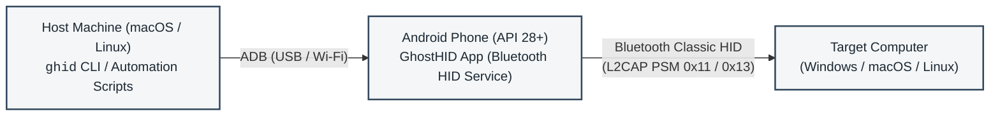

# ghid-cli

Command-line companion and terminal UI for [GhostHID](https://github.com/ShubhamJ010/ghost-hid).

GhostHID turns an Android phone into a physical Bluetooth Human Interface Device (HID) peripheral. `ghid-cli` controls the phone over ADB through USB or Wi-Fi. It sends keystrokes, mouse clicks, key combos, and automated login sequences to a paired Windows, macOS, or Linux computer. The target computer requires no drivers or companion software. It detects the phone as a standard wireless keyboard and mouse.



## Why GhostHID

macOS cannot act as a Bluetooth HID device to control another computer. Android 9 and newer includes the `BluetoothHidDevice` API. GhostHID uses an Android phone as an input bridge, letting scripts and terminal tools on macOS or Linux type and click on a separate computer.

### Automation and agent support

- Every command supports `--json` for scripts, CI pipelines, and automated tools.
- In JSON mode, `ghid-cli` disables interactive prompts and alternate screen buffers.
- Exit codes distinguish transport drops from invalid arguments and device errors.
- Low-latency keystroke injection, bracket macro sequences, and raw HID reports allow full target control without accessibility APIs.

## Documentation index

- [System architecture specification](docs/architecture.md): Subsystem topology, foreground service lifecycle, dual-report HID descriptor bytecode, and security model.
- [Execution and lifecycle flows](docs/flows.md): Sequence diagrams for login sequences, combo execution, Bluetooth SDP handshakes, and ACPI sleep teardown.
- [Wire and report protocol specification](docs/protocol-spec.md): Binary report payloads, L2CAP channels, USB HID scancode translation table, and ADB intent extras.
- [Troubleshooting and operational runbook](docs/troubleshooting.md): Diagnosis for ADB transport drops, Windows driver binding issues, Bluetooth desync, and Keychain access over SSH.
- [Automation and agent integration guide](docs/agent-integration.md): Machine-readable `--json` schemas, exit codes, and integration recipes.
- [Android companion repository](https://github.com/ShubhamJ010/ghost-hid): Standalone Android app, Material 3 UI, and Gradle release pipeline.
- [Architecture decision records](docs/decisions/):
  - [ADR-001: Headless Android Service with BroadcastReceiver IPC over ADB](docs/decisions/ADR-001-headless-android-service-adb-ipc.md)
  - [ADR-002: Dual-Report HID Descriptor for Keyboard and Mouse](docs/decisions/ADR-002-dual-report-descriptor-for-keyboard-and-mouse.md)
  - [ADR-003: Charm TUI with Structured JSON API and Native Credential Vault](docs/decisions/ADR-003-charm-tui-with-json-agent-api-and-keychain-vault.md)
  - [ADR-004: Snippets Subsystem, Dynamic Combo Variables, and Unified Quick Send](docs/decisions/ADR-004-snippets-subsystem-and-quick-send.md)
  - [ADR-005: Combo Metadata and Unified Stepper Engine](docs/decisions/ADR-005-combo-metadata-and-unified-stepper.md)
  - [ADR-006: Standalone Android Material 3 Expressive UI with Bi-directional Shared State](docs/decisions/ADR-006-material3-expressive-android-ui-and-shared-state.md)
  - [ADR-007: Passive Target Host OS Fingerprinting](docs/decisions/ADR-007-host-os-fingerprinting.md)
  - [ADR-008: Composite HID Report Descriptor and Auto-Inferred Raw Dispatch](docs/decisions/ADR-008-composite-descriptor-and-auto-inferred-raw-dispatch.md)
  - [ADR-009: Bi-directional Synchronization and Android as Single Source of Truth](docs/decisions/ADR-009-bidirectional-sync-and-android-ssot.md)
  - [ADR-010: macOS and Cross-Platform Gestures Adaptation](docs/decisions/ADR-010-macos-and-cross-platform-gesture-adaptation.md)
  - [ADR-011: Quick Send Unified Iconography and Device-Driven Host Coupling](docs/decisions/ADR-011-quick-send-unified-iconography-and-host-coupling.md)
  - [ADR-012: Single Non-Headless Android App and Release-Only Deployment](docs/decisions/ADR-012-single-android-app-and-release-only-deployment.md)
  - [ADR-013: Combo Emoji Icon Override](docs/decisions/ADR-013-combo-emoji-icon-override.md)
  - [ADR-014: Raw Snippets, Security Boundary, and Material 3 Expressive Controls](docs/decisions/ADR-014-raw-snippets-security-boundary-and-m3-expressive-controls.md)
  - [ADR-015: Unified Bracket Sequence DSL and Payload Subsystem](docs/decisions/ADR-015-unified-bracket-sequence-dsl-and-payloads.md)

## Quick start

### 1. Install the CLI
Symlink `ghid` into your path and install the manual page:

```bash
./ghid install-bin
```

Verify the installation:
```bash
which ghid
man ghid
```

To remove the link and manual page:
```bash
ghid uninstall-bin
```

### 2. Connect the phone via ADB
Enable Developer Options and USB Debugging on the phone. Connect over USB or Wi-Fi:

```bash
adb connect 192.168.1.80:41839
```

### 3. Install the Android companion app
Install the [GhostHID Android APK](https://github.com/ShubhamJ010/ghost-hid/releases):

```bash
ghid install-apk
```

### 4. Pair the phone to the target computer
Pair the phone and target computer over Bluetooth before first use. See [Bluetooth pairing setup](#bluetooth-pairing-setup) for the required pairing options.

> [!NOTE]
> During ACPI sleep states such as Modern Standby, S3, or S4, most laptops turn off their internal Bluetooth controllers. Tap a key or press the power button on the target laptop to wake the Bluetooth radio before connecting with `ghid`.

## Interactive console

Running `ghid` without arguments opens the full-screen terminal console:

```bash
ghid
```

```text
┌────────────────────────────────────────────────────────┐
  Phone Device:    KB2001 (192.168.1.80:41839)
  Gateway HID:     READY
  Target Laptop:   LP-TZD-0X114650 [38:FC:98:E8:E3:87] -> ● CONNECTED
  Cached Login:    Administrator
└────────────────────────────────────────────────────────┘
Actions:
  [1] login      - Automated Windows unlock and login
  [2] lock       - Lock Windows screen (Win + L)
  [3] sleep      - Hardware ACPI sleep sequence
  [4] type       - Inject text string via keyboard
  [5] combo      - Combo Studio (create, send, delete combos)
  [6] raw        - Inject raw 16-hex byte HID report
  [7] creds      - View and update cached login credentials
  [d] devices    - Registered target devices and pair new laptop
  [8] reconnect  - Re-trigger Bluetooth connection
  [9] doctor     - Run full hardware and gateway diagnostic check
  [0] exit       - Disconnect Bluetooth and stop phone service
```

## Command-line usage and automation API

All commands accept `--json` for automation.

### Diagnostics (`doctor`)
Checks ADB connectivity, package installation, Bluetooth status, profile registration, target connection, and Keychain storage:

```bash
ghid doctor --json
```

Example JSON response:
```json
{
  "adb_available": true,
  "adb_path": "/opt/homebrew/bin/adb",
  "apk_installed": true,
  "bluetooth_on": true,
  "cached_user": "Administrator",
  "device_connected": true,
  "device_model": "KB2001",
  "device_name": "OnePlus 8T",
  "device_serial": "192.168.1.80:41839",
  "gateway_connected": true,
  "gateway_registered": true,
  "has_cached_password": true,
  "keychain_available": true,
  "registered_devices": 1,
  "selected_device": {
    "id": "dev-1",
    "name": "LP-TZD-0X114650",
    "address": "38:FC:98:E8:E3:87",
    "platform": "windows",
    "selected": true
  },
  "payloads_count": 3,
  "target_address": "38:FC:98:E8:E3:87",
  "target_laptop": "LP-TZD-0X114650",
  "version": "0.1.0"
}
```

### Connection status (`status`)
Inspects active connection state:

```bash
ghid status --json
```

Exits with code 0 if the HID link is connected, and code 1 if disconnected.

### Automated login (`login`)
Unlock using stored Keychain credentials:

```bash
ghid login
```

Store credentials in Keychain and unlock:
```bash
ghid login -u "Administrator" -p "SecretPassword123" --save
```

### Screen lock and sleep (`lock`, `sleep`)
```bash
# Lock screen with Win + L
ghid lock

# ACPI sleep sequence with 5-second countdown
ghid sleep --countdown 5
```

### Bi-directional sync (`sync`)
The Android app storage at `/sdcard/Android/data/com.sj010.ghid/files/` is the authoritative source for combos and payloads. The CLI pulls updates from the phone on startup. CLI updates push to the phone and refresh the app state:

```bash
# Bi-directional sync: pull remote changes, merge local additions, push back
ghid sync

# Pull only: phone wins conflicts, keeps local additions
ghid sync --pull

# Push only: pushes local cache, scrubs secrets, reloads phone app
ghid sync --push

# Machine-readable output
ghid sync --json
```

Secure payload values stay in the local Keychain and never cross the link. Remote references arrive scrubbed and sync counts them as `payloads_skipped_secure`.

### Quick send (`quick`)
Unified entry point for typing text, action sequences, and raw HID reports. Report ID is inferred from byte length:

```bash
# Keystroke typing
ghid quick "git status"
ghid quick "Administrator" --json

# Chained macros and media keys
ghid combo "{playpause}" --json
ghid combo "{PLAY_PAUSE}" --json
ghid combo "{WIN_SLEEP}" --json

# Raw HID reports with inferred report ID
ghid quick --raw "02"               # 1 byte  -> Report ID 3 (System Control: Sleep)
ghid quick --raw "cd00"             # 2 bytes -> Report ID 4 (Consumer: Play/Pause)
ghid quick --raw "01000000"         # 4 bytes -> Report ID 2 (Mouse: Left Click)
ghid quick --raw "08000f0000000000" # 8 bytes -> Report ID 1 (Keyboard: Win/Cmd + L)
```

### Mouse actions (`click`, `mouse`)
GhostHID operates at the USB HID report layer without knowledge of screen geometry. Mouse clicks execute at the cursor's current resting position:

```bash
# In-place clicks
ghid click                          # Left click
ghid click left                     # Explicit left click
ghid click right                    # Right click
ghid click middle                   # Middle click
ghid click double                   # Double click
ghid click --count 3                # Consecutive clicks

# Mouse gesture dispatcher
ghid mouse click-left
ghid mouse scroll-up
ghid mouse scroll-down
```

### Combos and macros (`combo`)
```bash
# Keyboard chords
ghid combo "win+r"
ghid combo "ctrl+shift+esc"

# Mouse gestures on Report ID 2
ghid combo mouse click-left
ghid combo mouse scroll-up

# Token and syntax discovery
ghid combo schema --json
ghid combo keys --json

# Validate sequence syntax
ghid combo validate "{mod+s}{700ms}rustdesk{400ms}{Enter}" --json
ghid combo validate "{cmd+s}" --os macos --json

# Save named combo
ghid combo save "Open RustDesk" "{mod+s}{700ms}rustdesk{400ms}{Enter}" --os windows --emoji "🚀" --json
ghid combo save "Spotlight" "cmd+space" --os macos --emoji "🔍" --json

# List, send, and delete combos
ghid combo list --json
ghid combo list --os macos --json
ghid combo send "Open RustDesk" --json
ghid combo delete "Open RustDesk" --json
```

Saved combos live in `~/.config/ghid/combos.json`.

### Target device management (`devices`)
Manage multiple target computers:

```bash
# Scan bonded Bluetooth devices from the phone
ghid devices scan --json

# List registered target devices
ghid devices list --json

# Register target computer
ghid devices add --name "MacBook Pro M3" --addr "F8:FF:C2:11:22:33" --os macos --select

# Switch active connection
ghid devices select "dev-1"
ghid devices select "F8:FF:C2:11:22:33"
ghid devices select "MacBook Pro M3"

# Remove target device
ghid devices delete "F8:FF:C2:11:22:33" -f
```

Profiles live in `~/.config/ghid/config.json`.

### Credential vault (`creds`)
Manage credentials stored in the macOS Keychain under service `ghost-hid`:

```bash
ghid creds status --json
ghid creds set -u "Administrator" -p "SecretPassword123"
ghid creds clear
```

### Log viewing (`logs`, `tail`, `filelog`)
```bash
# Last 50 lines from Android gateway logcat
ghid logs -n 50

# Live stream logcat output
ghid tail

# Full persistent log from phone storage
ghid filelog
```

## Bracket sequence syntax

GhostHID uses a unified `{...}` bracket sequence syntax across Go, Kotlin, and the TUI:

```text
user@example.com{Tab}{PASSWORD}{Enter}{500ms}{mod+s}{100ms}{WIN_SLEEP}
```

### Syntax rules
1. Plain text outside braces is typed literally.
2. `{{` escapes a literal `{`.
3. Braced durations such as `{500ms}` and `{1s}` introduce execution delays.
4. Tokens with `+` execute modifier chords such as `{mod+s}` and `{ctrl+alt+del}`. The `mod` modifier resolves to Command on macOS and Ctrl on Windows and Linux.
5. Standard keys include `{Tab}`, `{Enter}`, `{Escape}`, `{Space}`, and `{F1}` through `{F24}`. Consumer media keys include `{VolumeUp}`, `{VolumeDown}`, `{Mute}`, and `{playpause}`.
6. Mouse gestures include `{click-left}`, `{click-right}`, `{click-middle}`, `{double-click}`, `{scroll-up}`, and `{scroll-down}`.
7. Braced identifiers that are not keys or gestures, such as `{PASSWORD}`, `{EMAIL}`, or `{WIN_SLEEP}`, resolve against the payload store.

### Payloads (`ghid payload`)
Payloads store reusable text strings, secure credentials, and raw HID reports:

```bash
# List payloads
ghid payload list --json

# Store plain or raw payload
ghid payload set username "user@example.com"
ghid payload set WIN_SLEEP "02" --raw

# Store encrypted secret in hardware Keychain or Keystore enclave
ghid payload set password "Secret123!" --secure

# Read or delete payload
ghid payload get username
ghid payload delete username
```

## Bluetooth pairing setup

To ensure the target operating system binds the phone as an HID keyboard instead of an audio device:

1. Clear existing pairings on both the target computer and the phone with `ghid unpair`.
2. Run `ghid start` and verify `ghid status --json` shows `"registered": true`.
3. In Windows Settings -> Bluetooth & devices -> Bluetooth devices discovery, set discovery mode to **Advanced**.
4. Click **Add device > Bluetooth**, select the phone, and confirm the numeric passkey on both devices.

## Building from source

Prerequisites: Go 1.21 or newer.

```bash
go build -o ghid ./cmd/ghid
```

License: MIT
