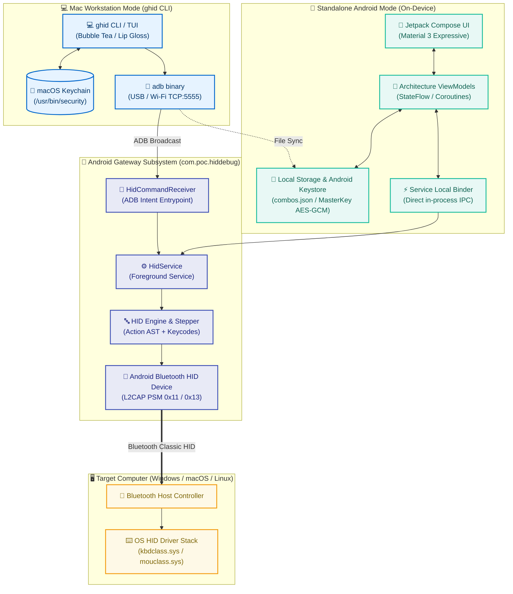
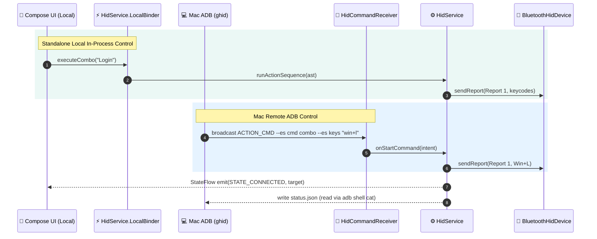
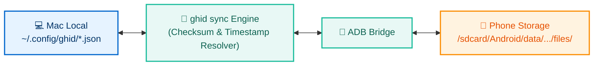
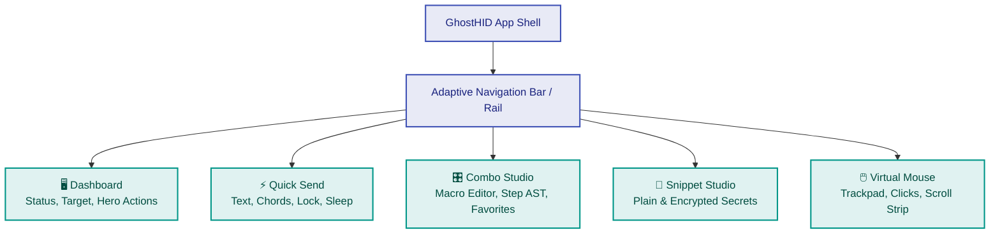

# GhostHID Android Standalone App: Material 3 Expressive Architecture & Design

## 1. Executive Summary

GhostHID transforms an Android smartphone into a hardware Bluetooth Classic Human Interface Device (HID) peripheral capable of injecting keystrokes, mouse pointer gestures, and credential sequences into a target host (Windows/macOS/Linux).

Previously, GhostHID operated in a **headless mode** on the phone: an Android foreground service (`HidService`) responding strictly to explicit broadcast intents sent over ADB from the macOS Go CLI (`ghid`).

This document specifies the architecture, user experience, and implementation design for the **GhostHID Standalone Android Application**. The app introduces a **Material 3 Expressive** user interface built with Jetpack Compose, granting the phone complete operational independence from the Mac workstation while keeping the Go CLI and ADB automation capabilities 100% intact with bi-directional shared state.



---

## 2. Core Architectural Principles & Invariants

1. **Dual Control Independence (No Regressions):**
   - The phone UI can connect, register SDP, trigger macros, edit snippets, and drive mouse movement without any USB cable or Wi-Fi connection to a Mac.
   - The Mac `ghid` CLI and TUI continue functioning over ADB without behavioral deviation. The `HidService` accepts both local Binder calls and external ADB broadcast intents concurrently.
2. **Material 3 Expressive (Compose-First):**
   - Built on `androidx.compose.material3` adhering to Google I/O 2026 Material 3 Expressive guidance.
   - Dynamic Color (Monet), tonal surface elevation, 8dp spacing grid, extra-rounded corner tokens, and physics-based spring motions.
3. **Shared State & Parity:**
   - Same combo grammar: `step ->{delay} step` with Windows key tokens, mouse gestures, and directives (`!DISCONNECT`, `!EXIT`).
   - Same variable expansion system: `$USERNAME`, `$PASSWORD`, and custom variables.
   - Uniform JSON schemas for `combos.json` and `snippets.json`.
4. **Hardware-Backed Security:**
   - Plaintext credentials are never committed to git, unencrypted flash, or shell logs.
   - Mac credentials live in macOS Keychain (`/usr/bin/security`).
   - Android credentials live in the Android Keystore via `EncryptedSharedPreferences` (AES-256-GCM with hardware-backed StrongBox / TEE when available).

---

## 3. System Topology & Dual IPC Architecture

### 3.1 Dual-Entry Foreground Service (`HidService`)

The Android `HidService` acts as the single source of truth for Bluetooth HID communication. It serves two distinct clients:



#### Service Seam Interface:
```kotlin
interface HidGatewayController {
    val connectionState: StateFlow<ConnectionState>
    val registeredTarget: StateFlow<BluetoothDevice?>
    val isSdpRegistered: StateFlow<Boolean>
    val logHistory: StateFlow<List<LogEntry>>

    fun registerApp()
    fun connectTarget(address: String?)
    fun disconnectTarget()
    fun unpairTarget(address: String?)

    fun sendKey(modifier: Byte, keyCode: Byte, durationMs: Long = 40)
    fun typeText(text: String)
    fun sendCombo(chordOrSequence: String)
    fun sendMouse(action: String)
    fun sendRawReport(report: ByteArray)
    fun sendMouseMove(dx: Int, dy: Int, wheel: Int = 0, buttons: Byte = 0)
}
```

---

## 4. Shared State & Secure Vault Design

### 4.1 Storage Architecture

Both the Mac workstation and Android smartphone read and modify the combo and snippet definitions.

| Concept | Mac Workstation Storage | Android App Storage | Sync Transport |
|---|---|---|---|
| **Combos** | `~/.config/ghid/combos.json` | `/sdcard/Android/data/com.poc.hiddebug/files/combos.json` | ADB File Push/Pull / In-App Import/Export |
| **Plain Snippets** | `~/.config/ghid/snippets.json` | `/sdcard/Android/data/com.poc.hiddebug/files/snippets.json` | ADB File Push/Pull / In-App Import/Export |
| **Secure Snippets** | macOS Keychain (`service: ghost-hid`) | Android Keystore (`MasterKey` AES-256-GCM) | Interactive Auth Transfer or Manual Entry |
| **Active Target** | `~/.config/ghid/config.json` | `SharedPreferences` (`active_target_mac`) | Device Independent |

### 4.2 Android Secure Vault (`AndroidKeystoreVault`)

The Android counterpart to Go's `vault.KeychainVault` uses Google's `androidx.security.crypto`:

```kotlin
class AndroidKeystoreVault(context: Context) : Vault {
    private val masterKey = MasterKey.Builder(context)
        .setKeyScheme(MasterKey.KeyScheme.AES256_GCM)
        .setRequestStrongBoxed(true) // Use dedicated hardware enclave if available
        .build()

    private val securePrefs = EncryptedSharedPreferences.create(
        context,
        "ghost_hid_secure_vault",
        masterKey,
        EncryptedSharedPreferences.PrefKeyEncryptionScheme.AES256_SIV,
        EncryptedSharedPreferences.PrefValueEncryptionScheme.AES256_GCM
    )

    override fun get(key: String): String? = securePrefs.getString(vaultKey(key), null)

    override fun set(key: String, value: String) {
        securePrefs.edit().putString(vaultKey(key), value).apply()
    }

    override fun delete(key: String) {
        securePrefs.edit().remove(vaultKey(key)).apply()
    }

    override fun isAvailable(): Boolean = true

    private fun vaultKey(name: String) = "ghost-hid:snippet:${name.trim().lowercase()}"
}
```

### 4.3 Bi-directional Sync Protocol (`ghid sync`)

A new Go CLI command (`ghid sync`) provides zero-fuss bidirectional synchronization over ADB:



- `ghid sync pull`: Pulls `combos.json` and non-secure snippets from phone, merging by `updated_at` / `created_at`.
- `ghid sync push`: Pushes local combos and non-secure snippets to phone external storage.
- `ghid sync status`: Inspects diffs, item count, and hash parity.
- **Secure Variable Protection:** When a snippet has `secure: true`, values in the JSON file remain empty strings `""`. Values are retrieved strictly in-memory from Keystore on phone and Keychain on Mac.

---

## 5. Material 3 Expressive UI Design

### 5.1 Design System Foundations

In alignment with Google I/O 2026 Material 3 Expressive specifications:

- **Dynamic Color (Monet):** Utilizes `dynamicDarkColorScheme(context)` and `dynamicLightColorScheme(context)` on Android 12+ (API 31+). For older versions or custom branding, a high-contrast Cyberpunk / Tech Tonal scheme is provided (Deep Violet `#1B112C` surface, Electric Cyan `#00E5FF` primary, Coral `#FF5252` tertiary).
- **Typography Scale:** Emphasized display and title variants for quick scanning in high-stress IT/admin contexts.
- **Corner Radii:**
  - Standard Cards: `16dp` (Large) to `20dp` (Large-Increased).
  - Action Chips & Buttons: `9999dp` (Full pill).
  - Dialogs & Bottom Sheets: `28dp` (Extra-Large).
- **Spring Physics Motion:**
  - Spring-based animations for touch feedback, card expansions, and trackpad gestures.
  - Low bounce, medium stiffness for snappy hardware response feel.

### 5.2 Application Screen Architecture

The application adopts an **Adaptive Layout Scaffold** (Bottom Navigation for standard smartphones; Navigation Rail for foldables, tablets, and landscape devices).



### 5.3 Detailed Screen Specifications

#### Screen 1: Dashboard (`DashboardScreen.kt`)
- **Header:** Hero status card displaying Bluetooth HID state:
  - Green pulsing badge for `CONNECTED`.
  - Amber badge for `CONNECTING...` or `DISCONNECTED`.
  - Red badge for Bluetooth Disabled / SDP Unregistered.
- **Target Host Card:** Displays paired laptop/desktop name, MAC address, and quick **Connect / Disconnect / Unpair** buttons.
- **Quick Action Bar:** Prominent elevated buttons for instant execution:
  - 🔒 **Lock Workstation (Win+L)**
  - 🌙 **Sleep Workstation** (with 5s animated countdown cancel bar)
  - 🔑 **Execute Login Sequence**
- **Terminal Log Pane:** Collapsible, real-time log tail of gateway HID reports and connection events with copy/export options.

#### Screen 2: Quick Send (`QuickSendScreen.kt`)
- **Direct Text Input:** Outlined text field with clear button and "Send Typing" button. Typing executes at 25ms per character with progress feedback.
- **Modifier Key Matrix:** Toggleable chips: `[ Win ]`, `[ Ctrl ]`, `[ Alt ]`, `[ Shift ]`.
- **Key Chord Grid:** Quick taps for common navigation chords:
  - `Win + D` (Show Desktop)
  - `Alt + Tab` (Task Switcher)
  - `Ctrl + Shift + Esc` (Task Manager)
  - `Win + R` (Run Dialog)
  - `Win + X` (Power Menu)
- **Custom Key Injector:** Dropdown or search field for non-character keys (`Enter`, `Esc`, `Tab`, `F1-F12`, `PrintScreen`).

#### Screen 3: Combo Studio (`ComboStudioScreen.kt`)
- **Search & Filter:** Search bar filtering combos by name, tag, or favorite status.
- **Combo Cards:**
  - Header: Emoji avatar, Combo name, Favorite heart toggle (`❤️`).
  - Body: Visual representation of AST steps as styled pill badges (`[Win+R] ➔ [type:cmd] ➔ [Enter]`).
  - Action row: **Run** (primary filled tonal button), **Edit** (icon button), **Delete**.
- **Execution Overlay:** Visual progress step highlighting the currently executing step and countdown delay.
- **Interactive Combo Editor (Modal Bottom Sheet):**
  - Name, emoji selector, description.
  - Step builder: Visual builder or raw text mode with live syntax validation matching the Go grammar.

#### Screen 4: Snippet Studio (`SnippetStudioScreen.kt`)
- **Header:** Explanatory banner noting snippets are expanded dynamically in combos (e.g. `$USERNAME`, `$PASSWORD`).
- **Snippet Items:**
  - Card with name, created date, and masked/revealed value.
  - Shield badge (`🛡️ Secure`) for items backed by Android Keystore.
  - Eye icon button to reveal plaintext with biometric/PIN prompt.
- **Add/Edit Dialog:**
  - Name validation (alphanumeric + underscores).
  - Secure toggle: when enabled, persists into `AndroidKeystoreVault` and blanks out plaintext in JSON export.

#### Screen 5: Virtual Mouse / Trackpad (`TrackpadScreen.kt`)
- **Touch Surface:** Responsive canvas reporting delta touch movements `(dX, dY)` mapped directly to HID Report ID 2 mouse pointer packets.
- **Sensitivity Slider:** Adjustable multiplier for pointer acceleration.
- **Mouse Button Deck:**
  - Large **Left Click** and **Right Click** buttons with distinct tactile haptics.
  - Center **Middle Click / Scroll Toggle**.
- **Vertical Scroll Strip:** Dedicated right-edge touch area for mouse wheel scrolling up/down.

---

## 6. Monorepo Organization & Directory Layout

To maintain build cleanliness, modularity, and easy CI/CD integration, the project adopts a standard modern Android Gradle structure inside `android/` while preserving root operational scripts:

```
ghost-hid/
├── android/                         # Dedicated Android Project Root
│   ├── build.gradle.kts             # Top-level Gradle configuration
│   ├── settings.gradle.kts          # Module settings
│   ├── gradle/                      # Gradle wrapper (v8.7+)
│   │   └── wrapper/
│   │       ├── gradle-wrapper.jar
│   │       └── gradle-wrapper.properties
│   ├── gradlew                      # Unix Gradle executable
│   ├── gradlew.bat                  # Windows Gradle executable
│   └── app/                         # App module
│       ├── build.gradle.kts         # Jetpack Compose + Dependencies
│       ├── proguard-rules.pro
│       └── src/
│           ├── main/
│           │   ├── AndroidManifest.xml
│           │   ├── java/            # Existing / upgraded Java services
│           │   │   └── com/poc/hiddebug/
│           │   │       ├── HidService.java
│           │   │       └── HidCommandReceiver.java
│           │   ├── kotlin/          # Modern Kotlin M3 UI & Domain
│           │   │   └── com/poc/hiddebug/
│           │   │       ├── MainActivity.kt
│           │   │       ├── GhostHidApp.kt
│           │   │       ├── ui/
│           │   │       │   ├── theme/
│           │   │       │   │   ├── Color.kt
│           │   │       │   │   ├── Theme.kt
│           │   │       │   │   └── Type.kt
│           │   │       │   ├── navigation/
│           │   │       │   │   └── Screen.kt
│           │   │       │   ├── dashboard/
│           │   │       │   ├── quicksend/
│           │   │       │   ├── combos/
│           │   │       │   ├── snippets/
│           │   │       │   └── trackpad/
│           │   │       ├── domain/
│           │   │       │   ├── parser/      # Ported Kotlin AST Stepper
│           │   │       │   ├── model/       # Combo, Snippet, HidStep
│           │   │       │   └── resolver/    # Variable Resolver
│           │   │       └── data/
│           │   │           ├── ComboRepository.kt
│           │   │           ├── SnippetRepository.kt
│           │   │           └── AndroidKeystoreVault.kt
│           │   └── res/             # Modern resources (Drawables, M3 Themes, Icons)
│           └── test/                # Unit tests (AST, Parser, Vault)
├── cmd/
│   └── ghid/                        # Go CLI entrypoint
├── internal/                        # Go core packages (adb, gateway, combos, snippets)
├── docs/                            # Architecture docs and ADRs
│   ├── decisions/
│   │   └── ADR-006-material3-expressive-android-ui-and-shared-state.md
│   └── architecture.md
├── build.sh                         # Root build wrapper (delegates to Gradle)
├── goal.md                          # Caveman goals
├── plan.md                          # Caveman implementation plan
├── design.md                        # This document
└── README.md
```

---

## 7. Build System & Toolchain Integration

### 7.1 Gradle Wrapper & Compose Dependencies

The `android/app/build.gradle.kts` utilizes modern Android Gradle Plugin with Compose compiler:

```kotlin
plugins {
    alias(libs.plugins.android.application)
    alias(libs.plugins.kotlin.android)
    alias(libs.plugins.kotlin.compose)
    alias(libs.plugins.kotlin.serialization)
}

android {
    namespace = "com.poc.hiddebug"
    compileSdk = 35

    defaultConfig {
        applicationId = "com.poc.hiddebug"
        minSdk = 28
        targetSdk = 35
        versionCode = 2
        versionName = "2.0.0"
        testInstrumentationRunner = "androidx.test.runner.AndroidJUnitRunner"
    }

    buildFeatures {
        compose = true
    }

    compileOptions {
        sourceCompatibility = JavaVersion.VERSION_17
        targetCompatibility = JavaVersion.VERSION_17
    }

    kotlinOptions {
        jvmTarget = "17"
    }
}

dependencies {
    // Jetpack Compose BOM 2024+
    val composeBom = platform("androidx.compose:compose-bom:2024.10.00")
    implementation(composeBom)
    androidTestImplementation(composeBom)

    implementation("androidx.compose.material3:material3")
    implementation("androidx.compose.material:material-icons-extended")
    implementation("androidx.navigation:navigation-compose:2.8.3")
    implementation("androidx.lifecycle:lifecycle-viewmodel-compose:2.8.6")
    implementation("androidx.lifecycle:lifecycle-runtime-compose:2.8.6")

    // Security & Encrypted SharedPreferences
    implementation("androidx.security:security-crypto:1.1.0-alpha06")

    // Serialization & Coroutines
    implementation("org.jetbrains.kotlinx:kotlinx-serialization-json:1.7.3")
    implementation("org.jetbrains.kotlinx:kotlinx-coroutines-android:1.9.0")
}
```

### 7.2 Root `build.sh` Backward Compatibility

The root `build.sh` script is updated to execute `./gradlew :app:assembleDebug` and output `build/ghost-hid.apk`, ensuring existing developer habits (`./build.sh && ghid install-apk`) continue without friction.

---

## 8. Verification & Quality Assurance Strategy

1. **Unit Testing:**
   - Kotlin Action AST Parser: Validate against 100% of test cases in Go `internal/hid/action_test.go` and `internal/combos/store_test.go`.
   - Variable expansion: Ensure `$USERNAME`, `$PASSWORD`, and unknown tokens fail or resolve identically on both Go and Android engines.
   - Keystore Vault: Test encryption roundtrips and isolation.
2. **Integration Testing:**
   - Start `HidService` via Android Activity launch.
   - Fire ADB broadcast intent while Activity is in foreground. Verify no crashes or dropped reports.
   - Execute combo from Mac CLI; verify Compose UI reflects updated state via `StateFlow` collector.
   - Drive virtual trackpad on phone; verify cursor moves smoothly on target Windows laptop.
3. **Security Auditing:**
   - Inspect generated APK with `aapt2 dump` and verify permissions.
   - Confirm unencrypted external storage contains zero plaintext secrets.
