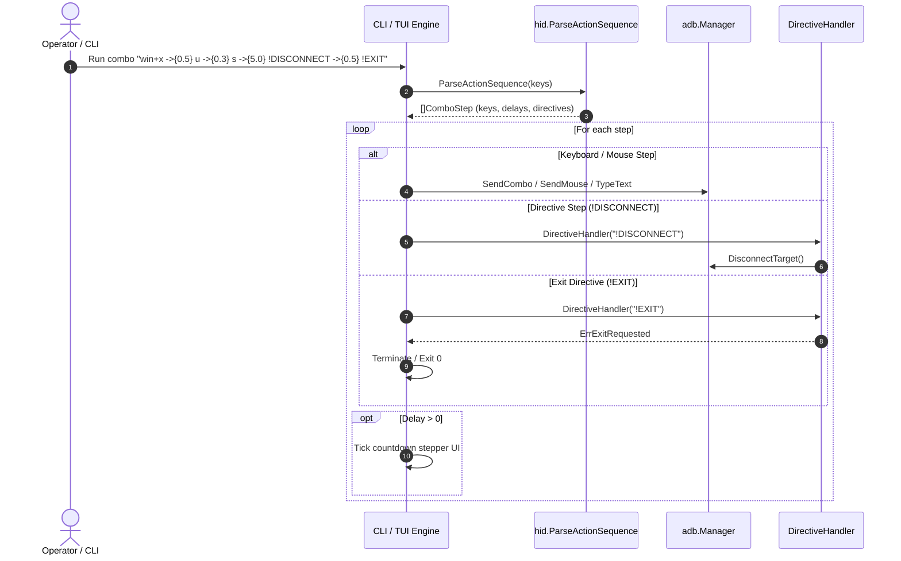

# ADR-005: Combo Metadata, System Directives, and Unified Countdown Stepper

## Status
Accepted

## Date
2026-10-23

## Context
Following the introduction of the Snippets subsystem and favorite macros (ADR-004), additional requirements arose around macro expressiveness, host lifecycle management, and user feedback:

1. **Macro Visual Identity & Metadata:** Pinned favorites and combo listings displayed bare combo names and keys. Operators had no way to assign distinctive visual indicators (emojis) or human-readable descriptions explaining what a combo accomplished.
2. **Built-in Redundancy & Fragmentation:** System actions such as `Lock` and `Sleep` were hardcoded separately from the Combo engine, resulting in fragmented dispatch paths, separate countdown implementations (`StateSleepCountdown` vs `StateLoginExecuting`), and inflexible timings.
3. **Lack of Lifecycle Directives:** Host-side automations often require device or session actions mid-sequence (e.g. putting a host to sleep, waiting 5 seconds, disconnecting Bluetooth, and cleanly exiting the CLI/TUI). Previously, sequences could only emit keyboard or mouse events.
4. **Disjoint Visual Feedback:** The sleep countdown card provided a smooth, informative countdown UI with an animated Lip Gloss progress bar, while login and other delayed combos used distinct, less informative or ad-hoc progress spinners.

## Decision

We designed and implemented a unified macro orchestration architecture comprising four key capabilities:

### 1. Combo Metadata (`Emoji` and `Description`)
- Extended `combos.Combo` with `Emoji string` and `Description string` fields.
- Stored and persisted in `~/.config/ghid/combos.json`.
- Displayed in `ghid combo list`, Combo Studio table, and serialized in `--json`.
- In dashboard favorite menus:
  - If `c.Emoji` is set, display it; otherwise fall back to `❤️`.
  - If `c.Description` is set, display it; otherwise fall back to `c.Keys` ("combo text").
- CLI `combo save` supports `--emoji <e>` and `--desc <d>` / `--description <d>`.

### 2. Built-in First-Class Combos
- Standard actions `Login`, `Lock`, and `Sleep` are now native built-in combos seeded into `combos.Store`:
  - **Login (`🔑`):** `ctrl+alt+del ->{1.0} esc ->{0.8} $USERNAME ->{0.8} tab ->{0.8} $PASSWORD ->{0.8} enter` (Description: *"Windows unlock & credential injection"*)
  - **Lock (`🔒`):** `win+l` (Description: *"Instant Windows lock screen (Win + L)"*)
  - **Sleep (`🌙`):** `win+x ->{0.5} u ->{0.3} s ->{5.0} !DISCONNECT ->{0.5} !EXIT` (Description: *"Windows sleep sequence + countdown exit"*)
- `combos.Store.Find()` guarantees fallback to these default definitions if missing from the user file.
- CLI subcommands `ghid lock` and `ghid sleep` dispatch directly through `dispatchCombo()`.

### 3. System Event Directives Subsystem (`!DIRECTIVE`)
- Introduced grammar support for event directives prefixed with `!`:
  - `!EXIT`: Dispatches terminal signal or exits process (`hid.ErrExitRequested`).
  - `!CONNECT` & `!CONNECT:<target>`: Triggers Bluetooth connection to default or specified target address.
  - `!DISCONNECT`: Disconnects active Bluetooth HID link.
  - `!RECONNECT`: Cycles Bluetooth connection.
  - `!START` / `!STOP` / `!RESTART`: Controls the Android background gateway service.
  - `!UNPAIR`: Clears Bluetooth pairing on the Android host.
  - `!COMBO:SEND:<name>`: Recursively invokes another saved combo by name (with recursion depth protection).
- Directives integrate seamlessly with timed transitions: `!DISCONNECT ->{0.5} !EXIT`.
- Decoupled via `adb.DirectiveHandler func(directive string) (bool, error)` on `adb.Manager` and `gateway.Gateway`.

### 4. Unified Countdown Stepper UI
- Combos with zero delay (e.g. `Lock` with `win+l`) execute immediately without blocking or displaying a modal countdown.
- Combos with cumulative delay (`totalDelay > 0`) enter `StateComboExecuting` using the unified countdown card UI:
  - Card width 52 with rounded borders.
  - Emoji and combo title header.
  - Subtitle showing description (or keys).
  - Cyan bold step indicator: `Step X of Y: <step details>`.
  - Animated Lip Gloss progress bar (`m.progress.ViewAs(pct)`).
  - Real-time remaining seconds badge (`Remaining: %.1fs`).
  - User cancellation support (`[Esc]` or `[q]`).

## Architecture & Directive Pipeline

## Consequences

### Positive
- **Declarative Host Control:** Sequences can now orchestrate entire host lifecycle sequences (lock, sleep, disconnect, power management) within a single chained string.
- **Consistent TUI Experience:** Operators see the exact same clean progress card with remaining time and step descriptions whether running Sleep, Login, or a custom deployment combo.
- **Instant Dispatch for Instant Combos:** Zero-delay macros bypass countdown screens entirely.
- **Rich Visual Identity:** Emojis and descriptions clarify purpose on both dashboard menu items and combo management tables.

### Neutral / Negative
- Directives prefixed with `!` are reserved keywords in the combo grammar; chords or text cannot start with `!` unless escaped or prefixed with `type:`.
